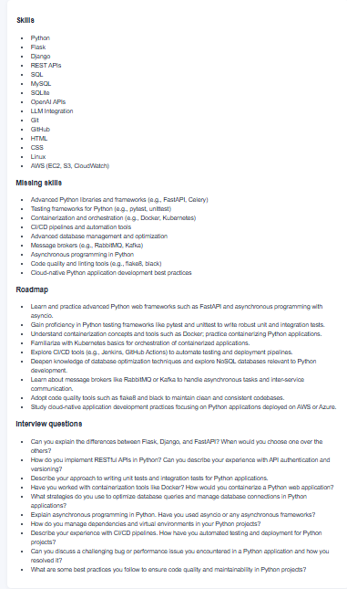

# AI Career Copilot (fixed project copy)

## Run in VS Code on Windows

1. Open this `resume` folder in VS Code.
2. In the terminal, create a fresh virtual environment (do not copy the old `venv`):

   ```powershell
   py -m venv venv
   .\venv\Scripts\Activate.ps1
   python -m pip install --upgrade pip
   pip install -r requirements.txt
   ```

3. Create `.env` and add your own `OPENAI_API_KEY`. The app uses local SQLite by default. so you can add plugin SQLlite Viewer in VS code
4. Run:

   ```powershell
   python app.py
   ```

5. Open `http://127.0.0.1:5000` in your browser.


### Resume Analysis Results




